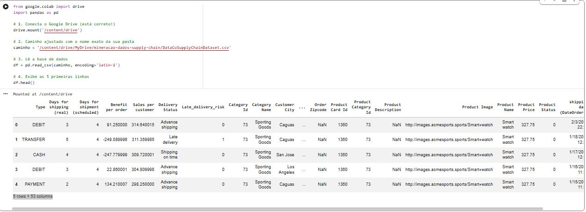
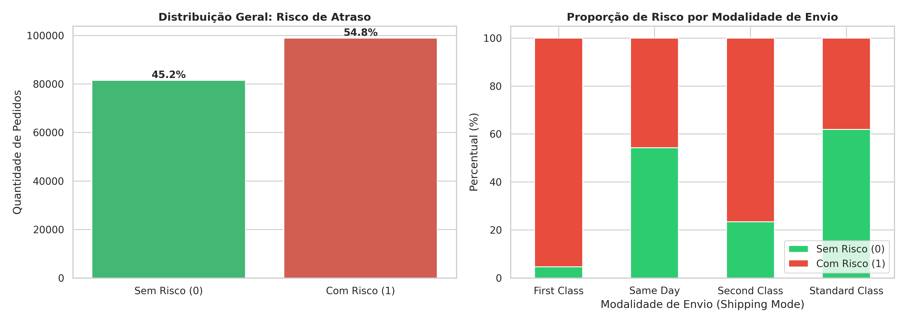

# 📦 Supply Chain Analytics: Previsão de Riscos e Atrasos Logísticos

## 🎯 1. Visão Geral do Projeto
Este projeto de **Data Mining e Machine Learning** tem como objetivo analisar a cadeia de suprimentos da base **DataCo Smart Supply Chain**, aplicando técnicas estatísticas e preditivas em Python para antecipar riscos de atrasos em entregas e otimizar processos logísticos e operacionais.

---

## 🛠️ 2. Stack Tecnológica
* **Linguagem:** Python 3
* **Ambiente:** Google Colab / Jupyter Notebook
* **Bibliotecas Principais:** `pandas`, `NumPy`, `scikit-learn`, `Matplotlib`, `Seaborn`, `mlxtend`
* **Visualização de Resultados:** Microsoft Power BI

---

## 📈 3. Ingestão e Inspeção Inicial dos Dados
A base de dados utilizada contém **180.519 registros e 53 variáveis** estruturadas cobrindo transações comerciais, datas de envio real vs agendado e status de entrega.

---

## 📊 4. Análise Exploratória de Dados (EDA)

A análise da variável alvo (`Late_delivery_risk`) revelou um cenário crítico de ineficiência operacional na cadeia de suprimentos:

* **Desequilíbrio Operacional:** **54,83%** dos pedidos (98.977 registros) apresentam risco real de atraso, contra **45,17%** (81.542 registros) entregues dentro do prazo.
* **Gargalo nos Fretes Expressos:** Ao cruzar o risco com a modalidade de envio (`Shipping Mode`), identificou-se que a categoria **First Class** concentra uma taxa de risco de **95,32%**, evidenciando falhas severas no cumprimento de SLAs prioritários. Em contrapartida, a modalidade **Standard Class** apresenta a maior previsibilidade, com **61,93%** das entregas sem risco.

---

## 🧹 5. Limpeza de Dados e Engenharia de Features

Para garantir a integridade estatística do modelo preditivo e evitar *Data Leakage* (vazamento de informações futuras que não existem no momento do despacho), a base passou por um rigoroso processo de higienização, reduzindo a dimensionalidade de **53 para 28 variáveis** sem perda de registros (180.519 linhas mantidas e 0 valores nulos):

* **Prevenção de Data Leakage:** Remoção de variáveis conhecidas apenas após o envio ou entrega (`Days for shipping (real)`, `Delivery Status`, `Order Status`, `shipping date`).
* **Tratamento de Nulos e Privacidade (LGPD):** Descarte de colunas inviáveis (`Product Description` com 100% de nulos e `Order Zipcode` com 86,2% de nulos) e remoção de dados pessoais sensíveis (e-mails, senhas, endereços exatos) e identificadores únicos (IDs).
* **Eliminação de Redundâncias:** Remoção de colunas financeiras espelhadas para evitar multicolinearidade.
* **Engenharia de Features Temporais:** Extração de `Order_Month` (mês), `Order_DayOfWeek` (dia da semana) e `Order_Hour` (hora do pedido) a partir do timestamp original para capturar gargalos operacionais de virada de turno e fins de semana.

---

## 🤖 6. Pré-processamento e Modelagem Preditiva (Baseline vs. Gradient Boosting)

Para preparar os dados para os algoritmos de classificação sem introduzir vazamento de dados (*Data Leakage*), foi estruturado um pipeline de transformação ajustado exclusivamente sobre o conjunto de treino:

- **Redução de Ruído Geográfico:** Exclusão de colunas de altíssima cardinalidade (`Order City`, `Order State`, `Order Country` e `Customer City`) para evitar explosão de dimensionalidade e *overfitting*, mantendo níveis agregados (`Market` e `Order Region`).
- **Divisão Estratificada (Train/Test Split):** Separação em **80% treino** (`144.415` registros) e **20% teste** (`36.104` registros), preservando a proporção original da variável alvo (`Late_delivery_risk`).
- **Codificação e Escalonamento (`ColumnTransformer`):**
  - `OneHotEncoder` para variáveis categóricas de baixa cardinalidade (`Type`, `Shipping Mode`, `Market`, `Customer Country`, `Customer Segment`, `Department Name`).
  - `OrdinalEncoder` para variáveis categóricas de média/alta cardinalidade (`Category Name`, `Customer State`, `Order Region`, `Product Name`).
  - `StandardScaler` aplicado às variáveis numéricas para garantir convergência dos algoritmos lineares.
  - Todo o ajuste (`fit`) foi executado exclusivamente em `X_train` e aplicado (`transform`) em `X_test`.

### 📊 Comparativo de Desempenho (Conjunto de Teste)

| Modelo | Acurácia (Treino) | Acurácia (Teste) | Precision (Classe 1) | Recall (Classe 1) | F1-Score (Classe 1) |
| :--- | :---: | :---: | :---: | :---: | :---: |
| **Logistic Regression (Baseline)** | 70,88% | 71,11% | 0,86 | 0,57 | 0,68 |
| **HistGradientBoostingClassifier** | 72,19% | 72,22% | 0,86 | 0,59 | 0,70 |

- **Diagnóstico Técnico:** Ambos os modelos mantiveram estabilidade entre treino e teste (ausência de *overfitting*). O ganho moderado (~1,11 p.p.) ao migrar de um modelo linear para um algoritmo baseado em árvores indica que o próximo salto de performance depende diretamente de engenharia de novas features e análise de importância das variáveis, além do ajuste do limiar de decisão (*threshold*) conforme o custo operacional de falsos negativos (*Recall* atual de 0,59 na classe de atraso).
